# 书转技能 · Book-to-Skill

> 把十本经典著作蒸馏成 AI Agent 可直接调用的技能包。
> Distilling ten classic books into AI-agent-ready skills.


[中文](#中文) · [English](#english)

---

## 中文

### 项目简介

**书转技能（Book-to-Skill）** 是一个“书籍 → 知识 → 可执行能力”的转换项目。它把 10 本哲学、控制论、系统科学、战略与领导力著作，加工成三种彼此衔接的产物：

| 产物 | 位置 | 用途 |
|---|---|---|
| 知识型 Skill | [`book-to-skill/`](book-to-skill/) | 供 AI Agent 按主题/章节加载的结构化知识库 |
| 能力型卡片 | [`cangjie-skill/`](cangjie-skill/) | 可检索、可调用、带边界说明的“能力卡” |
| 网页知识库 | [`app/`](app/) | 零构建的 Vue 3 单页浏览器，支持全文搜索与导航 |

所有内容均从原书文本蒸馏而来：先提取文本（扫描版 PDF 走 OCR），再按固定流水线生成章节摘要、术语表、方法模式、能力卡与精华摘要。项目同时保留了源文本与生成脚本，便于复核与再生成。

**规模统计**

| 指标 | 数量 |
|---|---:|
| 书籍 | 10 |
| 章节文档 | 80 |
| 能力卡 / 能力条目 | 50 |
| 术语条目 | 211 |
| 方法模式（Pattern） | 67 |
| 可安装 Skill | 10 |

### 书籍清单

| Slug | 书名 | 作者 | 领域 | 章节 | 能力 | 安装名 |
|---|---|---|---:|---:|---|
| `ljml` | 理解媒介：从对象到现象 | 芮必峰、孙爽 | 媒介 / 现象学 | 4 | 5 | `rui-media-phenomenology` |
| `dyxyly` | 第一性原理 | 李善友 | 思维 / 创新 | 8 | 5 | `li-first-principles` |
| `xtzm` | 系统之美 | 德内拉·梅多斯 | 系统思考 | 7 | 5 | `meadows-systems-thinking` |
| `qmyx` | 千面英雄 | 约瑟夫·坎贝尔 | 神话 / 原型 | 4 | 4 | `campbell-hero-journey` |
| `sk` | 失控 | 凯文·凯利 | 复杂系统 | 6 | 5 | `kelly-out-of-control` |
| `mzdxj` | 毛泽东选集 | 毛泽东 | 哲学 / 战略 | 9 | 5 | `mao-selected-works` |
| `gckzl` | 工程控制论 | 钱学森 | 控制论 / 工程 | 18 | 5 | `engineering-cybernetics` |
| `dyzx` | 第一哲学沉思集 | 笛卡尔 | 哲学 / 认识论 | 7 | 5 | `meditations-on-first-philosophy` |
| `ryryc` | 人有人的用处：控制论与社会 | N. 维纳 | 控制论 / 社会 | 12 | 6 | `human-use-of-human-beings` |
| `ysdlc` | 一生的旅程 | 罗伯特·艾格 | 领导力 / 传记 | 5 | 5 | `ride-of-a-lifetime` |

### 目录结构

```text
.
├── app/                              # Vue 3 静态知识浏览器
│   ├── index.html
│   ├── css/style.css
│   └── js/
│       ├── app.js                    # 搜索、书籍切换、章节展开、能力树
│       └── data.js                   # 由 _extracted/gen_data.py 生成（约 320 KB）
├── book-to-skill/                    # 格式 A：知识型 Skill（每书一个目录）
│   └── <slug>/
│       ├── SKILL.md                  # 入口：frontmatter + 核心框架 + 章节索引
│       ├── chapters/ch*.md           # 逐章核心思想
│       ├── glossary.md               # 术语表
│       ├── patterns.md               # 方法/模式及其适用条件
│       └── cheatsheet.md             # 决策规则与速查表
├── cangjie-skill/                    # 格式 B：能力卡（RIA++）
│   └── <slug>/
│       ├── BOOK_OVERVIEW.md          # 整书结构、核心命题、任务清单
│       ├── DIGEST.md                 # 一句话精华 + 核心洞察 + 关键判断
│       ├── GLOSSARY.md               # 术语网络
│       ├── PIPELINE_STATE.md         # 蒸馏阶段与能力统计
│       └── .cangjie/capabilities/
│           ├── verified.yaml          # 通过三重验证的能力清单与晋级结果
│           └── cards/*.md             # 单张能力卡（R/I/A1/E/B）
├── _extracted/                       # 原书提取文本 + 元数据 + gen_data.py
├── _ocr/                             # 渲染、OCR、清洗、校验、安装脚本
├── NOTE-scanned-pdfs.md              # 扫描版 PDF 的 OCR 处理记录
└── README.md
```

> `book-to-skill/ryrcyt/` 与 `cangjie-skill/ryrcyt/` 是同一本书另一 OCR 版本的占位目录，蒸馏未完成，未计入上述统计，可按需删除。

### 快速开始

#### 方式一：浏览器阅读

直接打开 [`app/index.html`](app/index.html)。页面通过 unpkg CDN 加载 Vue 3，首次打开需要联网。

若浏览器限制本地文件加载，可启动静态服务器：

```bash
python -m http.server 8000
# 打开 http://localhost:8000/app/
```

页面支持：书籍切换、全局关键词搜索（书/框架/能力/术语/章节）、章节展开、术语表、以及按 `promoted` / `router` 分层展示的能力调用链。

#### 方式二：安装为 AI 技能

每个 `book-to-skill/<slug>/` 目录都是一个符合 `SKILL.md` 约定（YAML frontmatter 提供 `name` 与 `description`）的技能包。以 Trae 为例：

```bash
mkdir -p ~/.trae-cn/skills
cp -r book-to-skill/xtzm ~/.trae-cn/skills/meadows-systems-thinking
```

PowerShell：

```powershell
Copy-Item -Recurse book-to-skill\xtzm "$HOME\.trae-cn\skills\meadows-systems-thinking"
```

也可使用批量安装脚本 [`_ocr/install_skills.py`](_ocr/install_skills.py)。脚本内 `SRC` / `DST` 为作者本机路径，运行前请改为你的本地路径：

```bash
python _ocr/install_skills.py
```

安装后的目录名与 `SKILL.md` 中的 `name` 保持一致，完整映射见[书籍清单](#书籍清单)。

#### 方式三：在对话中调用

Skill 支持三种调用方式：不带参数加载核心框架、按主题检索、按章节加载。

```text
用 meadows-systems-thinking 的十二大杠杆点分析我们团队的复盘流程
```

```text
用 engineering-cybernetics 判断这个带时滞的温度控制回路是否稳定
```

### 两种技能格式

#### 格式 A：知识型 Skill（`book-to-skill/`）

面向“阅读与检索”。入口是 `SKILL.md`：

```yaml
---
name: meadows-systems-thinking
description: "Knowledge base from 系统之美 by 德内拉·梅多斯. Use when applying systems thinking, analyzing feedback loops, ..."
---
```

`SKILL.md` 内含核心框架、章节索引、主题索引与支持文件链接；`chapters/` 提供逐章核心思想，便于 Agent 按需加载而不是一次吞下整本书。

#### 格式 B：能力卡（`cangjie-skill/`）

面向“判断与执行”。每本书先由 `verified.yaml` 定义能力条目（意图、关键词、一句话说明、重要度、关联能力、晋级结果），再由 `cards/` 中的能力卡展开。能力卡采用 RIA++ 结构：

| 段落 | 含义 |
|---|---|
| **R — Rationale** | 能力成立的原理与依据 |
| **I — Intent** | 什么情境下应调用它 |
| **A1 — 原书案例** | 书中的原始案例与论证 |
| **E — Execution** | 执行步骤、输入/输出、完成标准 |
| **B — Boundaries** | 边界、失效条件与不可替代的专业判断 |

能力有两种去向：`promoted`（可独立晋级的完整能力）与 `router`（需要配合主能力使用的路由型能力）。`also_read` 字段构成卡片间的 Zettelkasten 链接，`GLOSSARY.md` 提供跨卡片的术语锚点。

### 知识蒸馏流水线

```mermaid
flowchart LR
    A[PDF / 电子书] --> B{是否有文本层}
    B -- 是 --> C[PyMuPDF 提取文本层]
    B -- 否 --> D[300 DPI 灰度渲染 PNG]
    D --> E[Windows OCR zh-Hans-CN]
    C --> F[clean_text.py 清洗]
    E --> F
    F --> G[阶段 0 Adler 整书理解<br/>BOOK_OVERVIEW.md]
    G --> H[阶段 1 多 Agent 并行提取<br/>候选方法论单元]
    H --> I[阶段 1.5 三重验证<br/>verified.yaml]
    I --> J[阶段 1.6 晋级门<br/>promoted / router]
    J --> K[阶段 2 RIA++ 能力卡]
    K --> L[阶段 3 Zettelkasten 链接<br/>also_read + GLOSSARY]
    L --> M[阶段 4 压力测试]
    M --> N[阶段 5 编译与交付<br/>DIGEST + SKILL]
```



主要脚本：

| 脚本 | 作用 |
|---|---|
| [`_ocr/run_book.py`](_ocr/run_book.py) | 单本书 OCR/文本提取总控（渲染 → 识别 → 清洗） |
| [`_ocr/render_book.py`](_ocr/render_book.py) | PyMuPDF 按页渲染 PNG |
| [`_ocr/ocr_win.ps1`](_ocr/ocr_win.ps1) | 调用 Windows 内置 OCR |
| [`_ocr/clean_text.py`](_ocr/clean_text.py) | 去除汉字间多余空格、合并断行 |
| [`_ocr/validate_skills.py`](_ocr/validate_skills.py) | 校验 frontmatter、命名规范、章节引用完整性 |
| [`_ocr/verify_install.py`](_ocr/verify_install.py) | 校验已安装技能的数量、命名与引用 |
| [`_extracted/gen_data.py`](_extracted/gen_data.py) | 汇总各书产物，生成 `app/js/data.js` |
| [`_ocr/install_skills.py`](_ocr/install_skills.py) | 批量复制到本地 skills 目录 |

扫描版 PDF 的处理细节与质量限制见 [`NOTE-scanned-pdfs.md`](NOTE-scanned-pdfs.md)。

### 重新生成前端数据

修改书籍内容或新增书籍后，先编辑 [`_extracted/gen_data.py`](_extracted/gen_data.py) 中的 `BASE` 路径与 `BOOKS` 列表，然后运行：

```bash
python _extracted/gen_data.py
```

脚本会读取 `book-to-skill/` 与 `cangjie-skill/` 下的 Markdown/YAML，输出 `app/js/data.js`。

### 质量与限制

- **OCR 失真**：扫描版中的数学公式、矩阵、上下标在 OCR 后可能失真，《工程控制论》尤甚。章节论点与概念框架可用，具体公式请回查原书。
- **摘要不等于原文**：所有章节、能力卡与术语都是蒸馏产物，用于快速定位与推理，不替代原书论证。
- **能力卡不是专业模型**：控制论、系统动力学等主题的量化建模仍需专门工具与方法（如 Vensim、Stella）。
- **运行环境**：OCR 流水线依赖 Windows 内置 OCR 与 PyMuPDF；网页依赖 CDN 上的 Vue 3。
- **版本记录**：内容生成日期集中在 2026-10-24 至 2026-10-25，`PIPELINE_STATE.md` 记录了每本书的实际阶段与能力统计。

### 新增一本书

1. 将原书文本放入 `_extracted/`（扫描版先用 `_ocr/run_book.py` 处理）。
2. 新建 `book-to-skill/<slug>/`，按现有结构编写 `SKILL.md`、`chapters/`、`glossary.md`、`patterns.md`、`cheatsheet.md`。
3. 新建 `cangjie-skill/<slug>/`，完成 `BOOK_OVERVIEW.md`、`verified.yaml`、能力卡、`GLOSSARY.md`、`DIGEST.md`、`PIPELINE_STATE.md`。
4. 运行 `validate_skills.py` 与 `verify_install.py` 检查命名、frontmatter 与引用。
5. 更新 `gen_data.py` 的 `BOOKS` 列表，重新生成 `data.js`，并在本 README 的书籍清单中补一行。

### 版权与许可

- 本仓库未附带 `LICENSE` 文件；若计划公开分发代码与结构化产物，建议补充 MIT 或 Apache-2.0 等许可证。
- 书籍原文、译本及摘要内容的版权归原作者与译者所有。`_extracted/` 中的全文仅供个人学习与研究，请勿公开分发或用于商业用途。
- 引用本书库内容时，请同时标注原书作者与书名。

---

## English

### Overview

**Book-to-Skill** converts ten works spanning philosophy, cybernetics, systems science, strategy, and leadership into artifacts that an AI agent can actually use. Each book yields three linked products:

| Artifact | Location | Purpose |
|---|---|---|
| Knowledge skill | [`book-to-skill/`](book-to-skill/) | A structured knowledge base loaded by topic or chapter |
| Capability cards | [`cangjie-skill/`](cangjie-skill/) | Searchable, invocable capability cards with explicit boundaries |
| Web explorer | [`app/`](app/) | A zero-build Vue 3 single-page browser with full-text search |

Everything is distilled from the source texts. Scanned PDFs are OCR'd first; then a fixed pipeline produces chapter summaries, glossaries, patterns, capability cards, and digests. Source texts and generation scripts are kept in the repository so results can be audited and regenerated.

**At a glance**

| Metric | Count |
|---|---:|
| Books | 10 |
| Chapter documents | 80 |
| Capability cards / entries | 50 |
| Glossary terms | 211 |
| Method patterns | 67 |
| Installable skills | 10 |

### Book catalogue

| Slug | Book | Author | Domain | Chapters | Capabilities | Skill name |
|---|---|---|---|---:|---:|---|
| `ljml` | Understanding Media: From Object to Phenomenon | Rui Bifeng, Sun Shuang | Media / phenomenology | 4 | 5 | `rui-media-phenomenology` |
| `dyxyly` | First Principles | Li Shanyou | Thinking / innovation | 8 | 5 | `li-first-principles` |
| `xtzm` | Thinking in Systems | Donella Meadows | Systems thinking | 7 | 5 | `meadows-systems-thinking` |
| `qmyx` | The Hero with a Thousand Faces | Joseph Campbell | Myth / archetypes | 4 | 4 | `campbell-hero-journey` |
| `sk` | Out of Control | Kevin Kelly | Complex systems | 6 | 5 | `kelly-out-of-control` |
| `mzdxj` | Selected Works of Mao Zedong | Mao Zedong | Philosophy / strategy | 9 | 5 | `mao-selected-works` |
| `gckzl` | Engineering Cybernetics | H. S. Tsien (Qian Xuesen) | Cybernetics / engineering | 18 | 5 | `engineering-cybernetics` |
| `dyzx` | Meditations on First Philosophy | René Descartes | Philosophy / epistemology | 7 | 5 | `meditations-on-first-philosophy` |
| `ryryc` | The Human Use of Human Beings | Norbert Wiener | Cybernetics / society | 12 | 6 | `human-use-of-human-beings` |
| `ysdlc` | The Ride of a Lifetime | Robert Iger | Leadership / memoir | 5 | 5 | `ride-of-a-lifetime` |

### Repository layout

```text
.
├── app/                              # Vue 3 static knowledge explorer
│   ├── index.html
│   ├── css/style.css
│   └── js/{app.js, data.js}          # data.js is generated by _extracted/gen_data.py
├── book-to-skill/                    # Format A: knowledge skills, one directory per book
│   └── <slug>/{SKILL.md, chapters/, glossary.md, patterns.md, cheatsheet.md}
├── cangjie-skill/                    # Format B: capability cards (RIA++)
│   └── <slug>/
│       ├── BOOK_OVERVIEW.md
│       ├── DIGEST.md
│       ├── GLOSSARY.md
│       ├── PIPELINE_STATE.md
│       └── .cangjie/capabilities/{verified.yaml, cards/*.md}
├── _extracted/                       # Extracted book texts, metadata, gen_data.py
├── _ocr/                             # Render / OCR / clean / validate / install scripts
├── NOTE-scanned-pdfs.md              # OCR record for scanned PDFs
└── README.md
```

> `book-to-skill/ryrcyt/` and `cangjie-skill/ryrcyt/` are placeholders for a second OCR run of the same book. The distillation was not completed, so they are excluded from the statistics above and can be deleted.

### Getting started

#### 1. Browse in a browser

Open [`app/index.html`](app/index.html). Vue 3 is loaded from the unpkg CDN, so the first load requires network access. If your browser blocks local file scripts:

```bash
python -m http.server 8000
# then open http://localhost:8000/app/
```

The explorer supports book switching, global keyword search across books, frameworks, capabilities, glossary terms, and chapters, plus per-chapter expansion and a capability tree grouped by `promoted` / `router`.

#### 2. Install as an AI skill

Every `book-to-skill/<slug>/` directory follows the `SKILL.md` convention: YAML frontmatter with `name` and `description`. For Trae:

```bash
mkdir -p ~/.trae-cn/skills
cp -r book-to-skill/xtzm ~/.trae-cn/skills/meadows-systems-thinking
```

PowerShell:

```powershell
Copy-Item -Recurse book-to-skill\xtzm "$HOME\.trae-cn\skills\meadows-systems-thinking"
```

Or use the batch installer [`_ocr/install_skills.py`](_ocr/install_skills.py). Its `SRC` / `DST` constants point to the author's machine; edit them before running:

```bash
python _ocr/install_skills.py
```

The installed directory name must match the `name` in `SKILL.md`. The full mapping is in the [book catalogue](#book-catalogue).

#### 3. Use it in a conversation

```text
Use the twelve leverage points from meadows-systems-thinking to analyze our team retrospective.
```

```text
Use engineering-cybernetics to determine whether this temperature loop with dead time is stable.
```

### The two skill formats

#### Format A: knowledge skill (`book-to-skill/`)

Optimized for reading and retrieval. The entry point is `SKILL.md`:

```yaml
---
name: meadows-systems-thinking
description: "Knowledge base from 系统之美 by 德内拉·梅多斯. Use when applying systems thinking, analyzing feedback loops, ..."
---
```

`SKILL.md` contains core frameworks, a chapter index, a topic index, and links to supporting files. `chapters/` holds one document per chapter so an agent can load only what it needs instead of ingesting the whole book.

#### Format B: capability cards (`cangjie-skill/`)

Optimized for judgment and execution. `verified.yaml` defines each capability entry (intent, keywords, one-liner, importance, related capabilities, promotion destination), and `cards/` expands it using the RIA++ structure:

| Section | Meaning |
|---|---|
| **R — Rationale** | Why the capability holds |
| **I — Intent** | When to invoke it |
| **A1 — Source case** | The original case and argument from the book |
| **E — Execution** | Steps, inputs/outputs, and completion criteria |
| **B — Boundaries** | Limits, failure conditions, and judgment that cannot be automated |

Capabilities have two destinations: `promoted` for standalone capabilities and `router` for routing capabilities that support a primary capability. `also_read` fields form Zettelkasten links between cards, and `GLOSSARY.md` provides shared terminology anchors.

### Distillation pipeline

```mermaid
flowchart LR
    A[PDF / ebook] --> B{Text layer?}
    B -- Yes --> C[Extract with PyMuPDF]
    B -- No --> D[Render PNG at 300 DPI]
    D --> E[Windows OCR zh-Hans-CN]
    C --> F[clean_text.py]
    E --> F
    F --> G[Stage 0: Adler whole-book reading<br/>BOOK_OVERVIEW.md]
    G --> H[Stage 1: parallel extraction<br/>candidate method units]
    H --> I[Stage 1.5: three-fold validation<br/>verified.yaml]
    I --> J[Stage 1.6: promotion gate<br/>promoted / router]
    J --> K[Stage 2: RIA++ capability cards]
    K --> L[Stage 3: Zettelkasten links<br/>also_read + GLOSSARY]
    L --> M[Stage 4: stress testing]
    M --> N[Stage 5: compile and deliver<br/>DIGEST + SKILL]
```



Key scripts:

| Script | Role |
|---|---|
| [`_ocr/run_book.py`](_ocr/run_book.py) | Per-book OCR/text driver (render → recognize → clean) |
| [`_ocr/render_book.py`](_ocr/render_book.py) | Page rendering via PyMuPDF |
| [`_ocr/ocr_win.ps1`](_ocr/ocr_win.ps1) | Windows built-in OCR wrapper |
| [`_ocr/clean_text.py`](_ocr/clean_text.py) | Removes spacing artifacts and merges broken lines |
| [`_ocr/validate_skills.py`](_ocr/validate_skills.py) | Validates frontmatter, naming, and chapter references |
| [`_ocr/verify_install.py`](_ocr/verify_install.py) | Verifies installed skills |
| [`_extracted/gen_data.py`](_extracted/gen_data.py) | Builds `app/js/data.js` from all artifacts |
| [`_ocr/install_skills.py`](_ocr/install_skills.py) | Batch-copies skills into a local skills directory |

OCR details and known quality limits are documented in [`NOTE-scanned-pdfs.md`](NOTE-scanned-pdfs.md).

### Regenerating the web data

After editing content or adding a book, update the `BASE` path and `BOOKS` list in [`_extracted/gen_data.py`](_extracted/gen_data.py), then run:

```bash
python _extracted/gen_data.py
```

The script reads Markdown/YAML from `book-to-skill/` and `cangjie-skill/` and writes `app/js/data.js`.

### Quality and limitations

- **OCR fidelity**: mathematical formulas, matrices, and sub/superscripts can be distorted after OCR, especially in *Engineering Cybernetics*. Chapter arguments and conceptual frameworks remain usable; verify formulas against the printed book.
- **Summaries are not the source**: chapters, cards, and glossaries are distilled artifacts for orientation and reasoning, not replacements for the original argument.
- **Cards are not quantitative models**: modeling work in cybernetics or system dynamics still requires dedicated tools (e.g., Vensim, Stella).
- **Runtime dependencies**: the OCR pipeline requires Windows OCR and PyMuPDF; the web explorer requires network access for the Vue 3 CDN.
- **Provenance**: generation dates are 2026-10-24 to 2026-10-25; each `PIPELINE_STATE.md` records the actual stages and capability counts for its book.

### Adding a book

1. Put the source text in `_extracted/` (run `_ocr/run_book.py` first for scanned PDFs).
2. Create `book-to-skill/<slug>/` with `SKILL.md`, `chapters/`, `glossary.md`, `patterns.md`, and `cheatsheet.md`.
3. Create `cangjie-skill/<slug>/` with `BOOK_OVERVIEW.md`, `verified.yaml`, capability cards, `GLOSSARY.md`, `DIGEST.md`, and `PIPELINE_STATE.md`.
4. Run `validate_skills.py` and `verify_install.py` to check naming, frontmatter, and references.
5. Add the book to `BOOKS` in `gen_data.py`, regenerate `data.js`, and add a row to the catalogue above.

### Copyright and licensing

- No `LICENSE` file is included. If you plan to distribute the code and structured artifacts publicly, add a license such as MIT or Apache-2.0.
- Copyright in the original books, translations, and summaries remains with the respective authors and translators. Full texts under `_extracted/` are for personal study and research only; do not redistribute them or use them commercially.
- When quoting this library, cite the original author and title as well.

---

<p align="center">书转技能 · Book-to-Skill · 2026</p>
</content>
